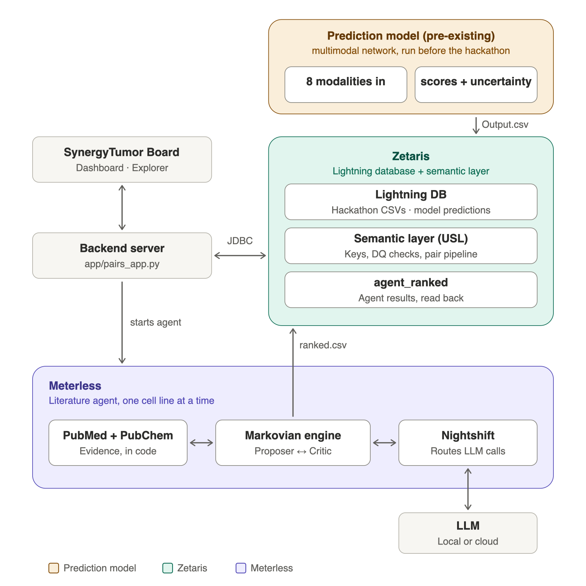

# SynergyTumor Board

**From AI prediction to clinician-ready evidence.** For a chosen cancer cell line, SynergyTumor Board
prioritises promising drug combinations: a multimodal model predicts synergy with uncertainty,
Zetaris filters out pairs that are not synergistic or not confidently predicted, and an agent
pipeline on the Meterless engine reviews the survivors against the literature through Meterless
Nightshift. The dashboard shows each step and ends with a clinician-ready overview per pair.



```
tissue + cell line ─► Zetaris: the multimodal model's predictions with uncertainty (Output.csv, pre-existing)
                      ─► Zetaris: 4.9M drug pairs → predictions → synergy filter → uncertainty filter
                      ─► Meterless agent: PubMed evidence, Proposer ⇄ Critic via Nightshift → keep / reject
                      ─► Zetaris (agent_ranked) ─► dashboard: funnels, query plans, clinician-ready overview
```

Example, UACC62 (skin): 4,921,927 drug pairs → 10,121 with predictions → 905 predicted synergistic
→ 432 confident (z_HSA ≥ 1) → 5 with literature support. 647V (urinary tract): 183 → 14 → 8 → 2.

## Components

| Part | What it does | Where |
|---|---|---|
| **Prediction model** (pre-existing) | Multimodal neural network built before the hackathon (5 drug and 3 cell-line modalities in; Loewe, Bliss, HSA and ZIP scores with uncertainty out). Only its output, `Output.csv`, is used: loaded into Zetaris | `data/Hackathon_data/Output_Prediction/` |
| **Zetaris** | Lightning database over the hackathon files and the model's predictions; semantic layer (USL) with keys and data quality checks; the whole pair pipeline as SQL; writes the model's input; reads the agent's results back | `sql/`, `app/pairs_app.py`, `app/dashboard.py` |
| **Meterless engine + Nightshift** | Literature agent: per pair, PubMed and PubChem retrieval in code, Proposer and Critic rounds on the Markovian engine, every model call through Nightshift, citations verified in code | `agent/` |
| **Dashboard** | Tissue and cell line selection, the interactive workflow (explore before running), stage tracker, three filtering funnels with their tables, Zetaris queries and plans, agent decisions, clinician-ready overview | `ui/SynergyTumor_Dashboard.html` at `/` |
| **Explorer** | The team's original page, connected to Zetaris | `ui/Drug_Synergy_Explorer.html` at `/explorer` |

How each sponsor technology is used, which Meterless engine was implemented and its test results,
how Nightshift powers the app, the coding tool, and what is pre-existing: see
[docs/HACKATHON_SUBMISSION.md](docs/HACKATHON_SUBMISSION.md).

## Repository layout

| Path | Contents |
|---|---|
| `ui/SynergyTumor_Dashboard.html` | The dashboard (main page) |
| `ui/Drug_Synergy_Explorer.html` | The team's original Explorer page |
| `app/pairs_app.py` | Backend: Zetaris connection, pipeline query, shortlist CSV, agent inputs, web server |
| `app/dashboard.py` | Dashboard back end: one Zetaris query per stage, modalities read from the data files |
| `agent/run_agent.sh` | The literature agent for one cell line |
| `agent/synergy_agent/` | The agent (TypeScript): retrieval, Proposer–Critic rounds, checks, scoring |
| `agent/reference/` | The Meterless Markovian engine (reference implementation) |
| `run_pipeline.sh` | Shortlist and agent for one cell line or all of them |
| `sql/` | Zetaris setup: source tables (01), semantic layer and data quality rules (02), checks (03), agent results table (04) |
| `setup/` | Load the data into Zetaris's volume, mount it, link the model's data, check everything |
| `data/` | Where the hackathon data goes (`data/Hackathon_data/`); the data is proprietary and not in the repository ([data/README.md](data/README.md)) |
| `results/` | Shortlists and agent results per cell line |
| `docs/` | Install guide, submission notes, architecture diagram, slides |

## Requirements

- Zetaris running locally in Docker, its JDBC driver JAR, Java 11+.
- Python 3.10+ for the backend (`requirements.txt`: JayDeBeApi, JPype1).
- The hackathon data folder, placed at `data/Hackathon_data/` (proprietary, not in the repository;
  [data/README.md](data/README.md)). Unpack the prediction file once with `setup/unpack_data.sh`.
- Agent: Node.js (LTS) and Meterless Nightshift with a local model or a provider key.

## Setup

Every step, with the queries and the expected output, is in
[docs/INSTALL_AND_CHECK.md](docs/INSTALL_AND_CHECK.md). In short:

0. Get the code, then place the hackathon data folder at `data/Hackathon_data/` (not in the repository)
   and unpack its prediction file:

   ```bash
   git clone https://github.com/Neginsh1995/drug-synergy-explorer.git
   cd drug-synergy-explorer && setup/unpack_data.sh
   ```

1. Backend environment: `python3 -m venv .venv && .venv/bin/pip install -r requirements.txt`
2. Settings: copy `.env.example` to `.env.local` and fill in the Zetaris JDBC URL, login, driver JAR
   (`HACKATHON_DATA_DIR` defaults to `data/Hackathon_data`). `.env.local` holds a password and is never committed.
3. Data into Zetaris: `setup/load_source_files.sh` (uses `data/Hackathon_data`); copy
   `setup/docker-compose.override.yml` into the Zetaris platform folder and run
   `docker compose up -d --no-deps driver` there.
4. Tables and semantic layer: run `sql/01_source_tables.sql`, then `sql/02_semantic_layer.sql`.
5. Agent: `cd agent/synergy_agent && npm ci`, `cd agent/reference && npm ci`; open Nightshift.
   After the first agent run, `sql/04_agent_results.sql` registers its results in Zetaris.
6. Check: `setup/check.sh`; every line reads `[PASS]` (or `[INFO]` for optional parts).

## Usage

**Dashboard**

```bash
.venv/bin/python app/pairs_app.py --serve
```

Open http://127.0.0.1:8765/. Before running, click any part of the workflow to see what it does, its
input and its output. Choose a tissue and a cell line, then **Run pipeline**: each stage runs as its
own Zetaris query and appears in the log with its SQL, rows, time and a link to its query plan
(http://localhost:4040/SQL/); click a funnel to see its table; the clinician-ready overview lists each
retained pair with its scores, uncertainty, drug targets and evidence. The team's Explorer page is at
http://127.0.0.1:8765/explorer.

**Literature agent**

```bash
./run_pipeline.sh 647V --examine 10 --keep 3   # one cell line
./run_pipeline.sh --all --skip-done            # every cell line
```

For each cell line: the shortlist and the agent's input from Zetaris, the agent's review through
Nightshift, then a refresh of `agent_ranked` in Zetaris. Settings in `.env.local`: `MAX_EXAMINE`,
`TARGET_KEEP`, `SYNERGY_ACCEPT` (`strict` or `include_mechanistic`), `METERLESS_MODEL` (the model
Nightshift routes to; default `meterless/auto`), `METERLESS_MAX_TOKENS` (reply limit sent with each call,
default 8000: without it Nightshift caps replies at 2,048 tokens and cuts the Proposer's answer off) and
`METERLESS_TIMEOUT_MS`. Every LLM call is logged with its role, round, drug pair, model and tokens. Each examined pair costs PubMed
calls and up to 6 model calls through Nightshift; if Nightshift routes to a paid cloud model, set a
spending limit with that provider. The Explorer page can also start the agent for a submitted cell
line (`AGENT_ON_SUBMIT=1`; off by default).

**Command line shortlist**

```bash
.venv/bin/python app/pairs_app.py UACC62
```

Prints the counts and writes `results/most_promising_UACC62_PubChemCID.csv` (33 columns, the team's format).

## Data

| File in `data/Hackathon_data` | Zetaris table (source → semantic layer) | Rows |
|---|---|---|
| `Output_Prediction/Output.csv` (stored as `.csv.gz`) | `predictions` → `synergy_results` | 719,112 |
| `Cell_Drug_Annotation_Mapping/Drug_metadata.csv` | `drug_metadata` → `drugs` | 3,139 |
| `Cell_Drug_Annotation_Mapping/cell_lines_metadata.csv` | `cell_lines_metadata` → `cell_lines` | 2,320 |
| `Whole_Samples/DrugComb_V2_measured_combinations.csv` | `measured_combinations` → `measured_combinations` | 359,556 |
| `Input_train_test_DataSamples_Drug_Drug_Cell/LOV_*.csv` (optional) | `lov_train`, `lov_test` (`sql/01b`) | 300,642 / 58,914 |
| `Drug_Modalities/*`, `Cell_Modalities/*` | read by the model and the dashboard's modality panel | |

The model's modalities are read from the files, and whether each describes drugs or cell lines is
decided by matching its ids against Zetaris: 5 drug modalities (ChemBERTa 384, RDKit 1,024, genetic
signature 978, morphology 487, bioassay 600 features) and 3 cell-line modalities (gene expression of
drug targets 1,161, lenient gene expression 16,720, CRISPR 970), plus a pathway table (4,761 × 1,834).

## The pipeline in Zetaris

1. **Cell line**: name → id and annotation (tissue, CCLE, DepMap, Cellosaurus).
2. **All drug pairs**: every pair of two different drugs, 4,921,927.
3. **Predictions**: each pair's model prediction for the cell line, both drug orders averaged.
4. **Prediction filter**: at least 3 of 4 scores predicted above 5 (and, where measured, above 6).
5. **Uncertainty filter**: `z_HSA = (Prediction_label_HSA − 5) / HSA_total_std ≥ 1`, ranked.
6. **Evidence filter**: the literature agent keeps pairs with experimental or pathway-level support.

Steps 2–5 are one SQL query; the shortlist for UACC62 is byte-identical to the team's pandas script.

## Test results

| What | Result |
|---|---|
| `setup/check.sh` | All checks pass: tables and row counts, semantic layer, 0 orphan predictions, UACC62 pipeline (4,921,927 → 10,121 → 905 → 432), top pair, agent, Nightshift, page server |
| Meterless Markovian engine (`agent/reference`, `npx vitest run`) | 10 of 10 tests pass |
| Agent (`agent/synergy_agent`, `npm test`) | 39 of 39 tests pass |
| Live agent run, 647V, through Nightshift | 8 pairs examined, 2 kept, every citation a retrieved PMID |

## Pre-existing work and licences

- **Prediction model, its trained weights and the feature datasets**: built by the team before the
  hackathon build window. The project uses only the model's output (`Output.csv`).
- **Meterless Markovian engine** (`agent/reference/`): Meterless reference implementation, Apache-2.0.
- **Zetaris getting-started SQL runner**: used to run `sql/`; not included.
- Open-source dependencies listed in `requirements.txt` and the `package.json` files.

Everything else (the Zetaris layer, backend, dashboard, agent integration, scripts) was written
during the hackathon.

## Credentials

No keys, tokens or passwords are in the repository. `.env.local` (Zetaris login, local paths) is
git-ignored; `.env.example` is the template. The Nightshift token is read at run time from
Nightshift's own token file. Data files are not committed (`.gitignore`).

## Notes and limits

- The prediction model is not part of the repository; the project uses its output as loaded in Zetaris.
- Every pair in the predictions file was also measured, so the shortlist holds pairs both predicted
  and measured as synergistic.
- The nominal 95% intervals held the measured value about 80% of the time on held-out pairs.
- Clinical phase in the drug metadata can be wrong (e.g. actinomycin D and fludarabine are approved).
- The server listens on 127.0.0.1 only; the backend sends only fixed read queries to Zetaris.
- Decision support for research, not a treatment recommendation.
